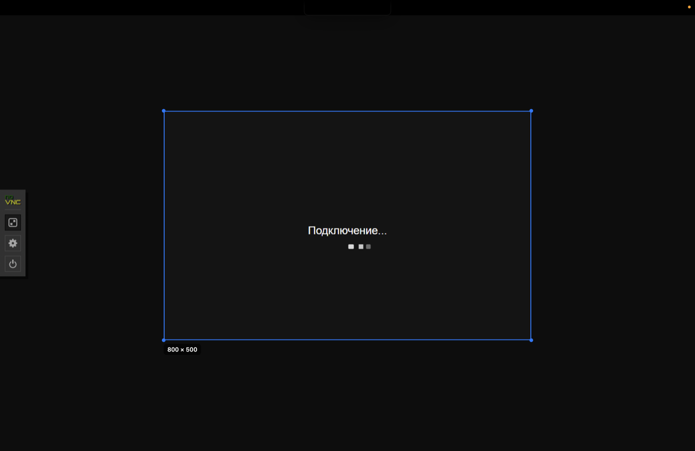

# ScreenTap

**Снимок выделенной области экрана по двойному нажатию обеих кнопок мыши — сразу в буфер обмена.**

Нажмите одновременно левую и правую кнопки мыши — появится режим выделения области.
Протяните мышь, отпустите кнопки — выделенный фрагмент уже лежит в буфере обмена.
Приложение живёт в меню-баре, не занимает место в Dock и не перехватывает обычные клики.




---

## Возможности

- **Жест «обе кнопки»** — одновременное нажатие левой и правой кнопок мыши открывает
  режим выделения. Работает и в обратном порядке, и двумя быстрыми кликами.
- **Снимок сразу в буфер** — PNG кладётся в `NSPasteboard.general`, вставка работает
  в любом приложении (`⌘V`).
- **Полноэкранный оверлей** — затемнение, рамка выделения с угловыми маркерами,
  счётчик размера, `Enter` — подтвердить, `Esc` — отменить.
- **Клик без перетаскивания** выделяет весь экран под курсором.
- **Меню-баре** — иконка в строке меню, запуск при входе, быстрый доступ к настройкам прав.
- **Звуковой отклик** — короткий щелчок подтверждает, что снимок сделан.
- **Никаких зависимостей** — чистый Swift и AppKit, без сторонних библиотек.

## Требования

- macOS 14 Sonoma или новее
- Xcode 16 / Swift 6 (только для сборки из исходников)

## Установка

### Из исходников

```bash
git clone https://github.com/skensell201/screentap.git
cd screentap
./Scripts/build.sh
```

Готовое приложение лежит в `build/ScreenTap.app`.

Чтобы разрешения и автозапуск работали стабильно, перенесите приложение в `/Applications`:

```bash
cp -R build/ScreenTap.app /Applications/
open /Applications/ScreenTap.app
```

### Первый запуск

macOS спросит два разрешения — они выдаются один раз в «Системных настройках»:

| Разрешение | Где выдать | Зачем |
|---|---|---|
| **Запись экрана** | Конфиденциальность и безопасность → Запись экрана | Захват изображения экрана. Без него снимок невозможен |
| **Универсальный доступ** | Конфиденциальность и безопасность → Универсальный доступ | Перехват нажатий обеих кнопок без показа контекстного меню |

«Универсальный доступ» необязателен: без него приложение работает, но при жесте
под курсором будет всплывать контекстное меню того приложения, в котором вы находитесь.

Из меню-баре можно в любой момент открыть нужную страницу настроек, включить
«Запускать при входе» и вручную запустить режим выделения.

## Использование

1. Нажмите **обе** кнопки мыши одновременно и отпустите их.
2. Появится полупрозрачный оверлей — протяните мышь, выделяя нужную область.
3. Отпустите кнопки. Снимок выбранной области окажется в буфере обмена.

Управление в режиме выделения:

| Действие | Результат |
|---|---|
| Протянуть мышь | Выделить область |
| `Enter` / `Space` | Подтвердить выделение |
| `Esc` | Отменить |
| Клик без перетаскивания | Выделить весь экран под курсором |

Горячие клавиши нет — жест «обе кнопки» и есть основной способ.

## Как это устроено

```
ChordDetector ──► ChordStateMachine ──► SelectionOverlay ──► ScreenCapturer ──► ClipboardWriter
  (CGEventTap          (чистая логика,        (окно выделения)   (ScreenCaptureKit)   (PNG в
   или NSEvent)         покрыта тестами)                                          буфер обмена)
```

| Модуль | Файл | Ответственность |
|---|---|---|
| `ChordStateMachine` | `ChordStateMachine.swift` | Чистая машина состояний: превращает поток нажатий в решение «жест распознан». Не зависит от AppKit, поэтому тестируется синтетическими событиями |
| `ChordDetector` | `ChordDetector.swift` | Источник событий: `CGEventTap` (умеет поглощать события) или `NSEvent`-мониторы как запасной вариант |
| `SelectionOverlay` | `SelectionOverlay.swift` | Полноэкранное окно выделения: затемнение, рамка, HUD, клавиатура |
| `ScreenCapturer` | `ScreenCapturer.swift` | Захват через `ScreenCaptureKit` с кадрированием по точкам; запасной путь через `CGWindowListCreateImage` |
| `ClipboardWriter` | `ClipboardWriter.swift` | PNG и TIFF в `NSPasteboard`, звуковой отклик |
| `LaunchAgentController` | `LaunchAgentController.swift` | Автозапуск через `~/Library/LaunchAgents` |
| `AppDelegate` | `AppDelegate.swift` | Меню-баре, разрешения, общий сценарий |

Ключевые решения:

- **Правый клик всегда поглощается и буферизуется.** Если жест не состоялся,
  нажатие возвращается в систему через `CGEvent.post` — контекстное меню открывается,
  просто чуть позже. Если жест состоялся, поглощаются обе кнопки и меню не появляется вовсе.
- **Левая кнопка не задерживается.** Задерживать все клики в системе на 200 мс ради
  одного жеста недопустимо, поэтому «жест с началом на левой кнопке» может оставить
  единичный лишний клик в приложении под курсором. Жест, начатый с правой кнопки, чистый.
- **Захват идёт в нативном разрешении дисплея** (`CGDisplayCopyDisplayMode`), а не в
  стандартных 1920×1080 — иначе ScreenCaptureKit растягивает картинку и кадрирование
  «едет».
- **Автозапуск сделан через LaunchAgent**, а не `SMAppService`: он работает независимо
  от того, где лежит `.app`, и не требует постоянной подписи.

## Разработка

```bash
# Сборка приложения
./Scripts/build.sh              # release
./Scripts/build.sh --debug

# Тесты логики распознавания жеста (без GUI)
.build/release/ScreenTap --selftest

# Прогон полного цикла: оверлей → выделение → снимок → буфер обмена
.build/release/ScreenTap --demo --debug

# Пересобрать иконку из исходника
./Scripts/make-icon.sh
```

Полезные флаги:

- `--debug` — подробный лог в stdout (события мыши, состояние жеста, параметры захвата).
- `--selftest` — прогон `ChordStateMachine` по 11 синтетическим сценариям
  (обычный клик, обычный правый клик, жест обеими руками в обе стороны, жест
  двумя кликами, перетаскивание, сброс состояния) и выход с кодом `0`/`1`.
- `--demo` — программный прогон выделения и снимка; результат сохраняется
  в `/tmp/screentap-demo.png`.

### Стабильная подпись (для разрешений)

По умолчанию приложение подписывается ad-hoc (`codesign -s -`). Идентичность TCC в
таком случае меняется при каждой пересборке, и разрешение «Запись экрана» приходится
выдавать заново. Чтобы этого избежать, используйте собственную self-signed
идентичность:

```bash
SCREENTAP_CODESIGN_IDENTITY="ScreenTap SelfSigned" ./Scripts/build.sh
```

### Структура репозитория

```
Sources/ScreenTap/     исходники Swift
Scripts/build.sh       сборка ScreenTap.app
Scripts/make-icon.sh   генерация AppIcon.icns из PNG
Scripts/pad-icon.swift подготовка полотна иконки 1024x1024
Resources/             AppIcon.icns и исходник иконки
docs/                  скриншоты и спецификация
```

## Известные ограничения

- **Нужен Accessibility** для «чистого» жеста. Без него контекстное меню приложения
  под курсором будет всплывать при нажатии обеих кнопок.
- **Нельзя отозвать уже доставленный клик.** Если жест начат с левой кнопки, она
  успевает нажать то, что под курсором.
- **Несколько мониторов**: оверлей покрывает их объединённую область, снимок берётся
  с экрана, на котором лежит большая часть выделения.
- **Снимок отражает состояние экрана на момент подтверждения**, буфер обмена
  перезаписывается.

## Лицензия

MIT — см. [LICENSE](LICENSE).
