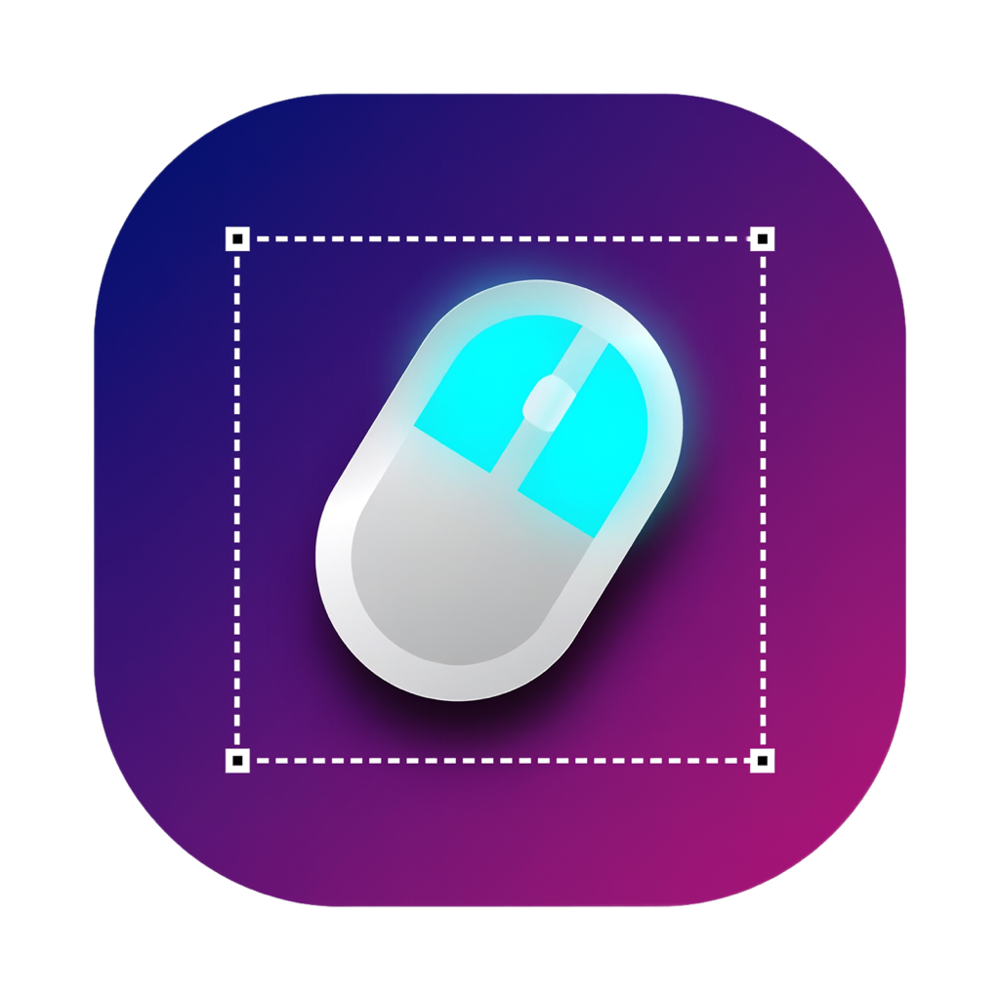

# ScreenTap

**Capture a selected screen area by pressing both mouse buttons at once — straight into the clipboard.**

Press the left and right mouse buttons simultaneously and the area selection mode opens up.
Drag with the mouse, release, and the captured region is already in your clipboard.
The app lives in the menu bar, keeps out of the Dock and never gets in the way of ordinary clicks.




> The image above is an illustration rendered by `Scripts/render-preview.swift`, not a screenshot
> of a real desktop.

---

## Features

- **The "both buttons" gesture** — pressing the left and the right mouse button at the same time
  opens the selection mode. Works in either order and as two quick clicks as well.
- **Straight into the clipboard** — the PNG lands in `NSPasteboard.general`, so pasting works
  everywhere (`⌘V`).
- **Full-screen overlay** — dimmed background, selection frame with corner handles, live size
  readout, `Enter` to confirm, `Esc` to cancel.
- **Click without dragging** selects the whole screen under the cursor.
- **Menu bar app** — icon in the menu bar, launch at login, quick access to the permission
  settings.
- **Audio feedback** — a short click confirms that the screenshot was taken.
- **No dependencies** — plain Swift and AppKit, no third-party libraries.

## Requirements

- macOS 14 Sonoma or newer
- Xcode 16 / Swift 6 (only needed to build from source)

## Installation

### From source

```bash
git clone https://github.com/skensell201/screentap.git
cd screentap
./Scripts/build.sh
```

The assembled application is written to `build/ScreenTap.app`.

Permissions and launch at login behave most reliably when the app lives in `/Applications`:

```bash
cp -R build/ScreenTap.app /Applications/
open /Applications/ScreenTap.app
```

### First launch

macOS asks for two permissions. They are granted once, in System Settings:

| Permission | Where to enable it | Why it is needed |
|---|---|---|
| **Screen Recording** | Privacy & Security → Screen Recording | Capturing the screen contents. Without it no screenshot can be taken |
| **Accessibility** | Privacy & Security → Accessibility | Intercepting the presses of both buttons without letting the context menu of the app under the cursor appear |

Accessibility is optional: without it the app still works, but the context menu of the
application under the cursor pops up when the gesture is used.

The menu bar icon opens both settings pages at any time, and it also holds the
"Launch at Login" switch, a manual trigger for the selection mode and a **Restart
ScreenTap** item — macOS applies permission changes to a running app only partially,
so a restart makes a freshly granted permission take effect immediately.

## Usage

1. Press **both** mouse buttons at the same time and release them.
2. A translucent overlay appears — drag with the mouse to select the area you need.
3. Release the buttons. The screenshot of the selected area is in your clipboard.

While the selection mode is active:

| Action | Result |
|---|---|
| Drag with the mouse | Select an area |
| `Enter` / `Space` | Confirm the selection |
| `Esc` | Cancel |
| Click without dragging | Select the whole screen under the cursor |

There are no keyboard shortcuts — the "both buttons" gesture is the primary way to use the app.

## How it works

```
ChordDetector ──► ChordStateMachine ──► SelectionOverlay ──► ScreenCapturer ──► ClipboardWriter
  (CGEventTap           (pure logic,          (selection window)   (ScreenCaptureKit)   (PNG into the
   or NSEvent)           covered by tests)                                          clipboard)
```

| Module | File | Responsibility |
|---|---|---|
| `ChordStateMachine` | `ChordStateMachine.swift` | Pure state machine that turns a stream of button presses into a "gesture recognised" decision. Free of AppKit, so it is testable with synthetic events |
| `ChordDetector` | `ChordDetector.swift` | Event source: `CGEventTap` (able to swallow events) or `NSEvent` monitors as a fallback |
| `SelectionOverlay` | `SelectionOverlay.swift` | Full-screen selection window: dimming, frame, size HUD, keyboard handling |
| `ScreenCapturer` | `ScreenCapturer.swift` | Capture via `SCScreenshotManager.captureImage(in:)` (region in Quartz coordinates), with a `ScreenCaptureKit` + crop path for older systems and `CGWindowListCreateImage` as the last resort |
| `ClipboardWriter` | `ClipboardWriter.swift` | PNG and TIFF into `NSPasteboard`, plus the sound feedback |
| `LaunchAgentController` | `LaunchAgentController.swift` | Launch at login through `~/Library/LaunchAgents` |
| `AppDelegate` | `AppDelegate.swift` | Menu bar, permissions, the overall flow |

Key decisions:

- **The right click is always swallowed and buffered.** If no gesture materialises, the
  press is handed back to the system through `CGEvent.post` — the context menu shows up,
  just a little later. If the gesture does materialise, both buttons are swallowed and the
  menu never appears at all.
- **The left button is never delayed.** Delaying every click in the system by 200 ms just to
  support one gesture is not acceptable, so a gesture that *starts* with the left button may
  leave a single stray click in the application under the cursor. A gesture that starts with
  the right button is clean.
- **The region is captured directly** with `SCScreenshotManager.captureImage(in:)` (macOS
  15.2+), which takes the rectangle in Quartz coordinates, works across multiple displays and
  — unlike enumerating the on-screen content — does not make macOS ask for the screen
  recording permission over and over. Older systems fall back to `ScreenCaptureKit` with a
  manual crop, and finally to `CGWindowListCreateImage`.
- **Launch at login uses a LaunchAgent** rather than `SMAppService`: it works no matter where
  the `.app` lives and does not require a permanent signature.

## Development

```bash
# Build the application
./Scripts/build.sh              # release
./Scripts/build.sh --debug

# Test the gesture recognition logic (no GUI)
.build/release/ScreenTap --selftest

# Run the full cycle: overlay → selection → capture → clipboard
.build/release/ScreenTap --demo --debug

# Rebuild the icon from the source PNG
./Scripts/make-icon.sh

# Re-render the selection mode illustration
swift Scripts/render-preview.swift docs/overlay.png
```

Useful flags:

- `--debug` — verbose log on stdout (mouse events, gesture state, capture parameters).
- `--selftest` — runs the `ChordStateMachine` against 11 synthetic scenarios (plain click,
  plain right click, the gesture in both orders, the gesture as two clicks, dragging, state
  reset) and exits with `0`/`1`.
- `--demo` — scripted selection and capture; the result is written to `/tmp/screentap-demo.png`.
- `--coord-test` — captures the top right corner of the screen (the menu bar clock) into
  `/tmp/screentap/coordtest.png` to verify the coordinate conversion.

### Stable code signature (for permissions)

By default the app is signed ad-hoc (`codesign -s -`). The TCC identity of an ad-hoc signed
app changes with every rebuild, which means macOS asks for the screen recording permission
again after each rebuild. To avoid that, sign the app with a certificate that has a stable
code requirement:

```bash
# One time: create a self-signed identity in a dedicated keychain
./Scripts/setup-signing.sh

# Every build
SCREENTAP_CODESIGN_IDENTITY="ScreenTap SelfSigned" ./Scripts/build.sh
```

`build.sh` also picks up the identity automatically when it is stored in the local
`.signing-identity` file (git ignored) or when a "ScreenTap SelfSigned" identity is present in
the keychain. Any other code signing identity works as well — for example an Apple
Development certificate that is already on the machine:

```bash
echo "Apple Development: you@example.com (XXXX)" > .signing-identity
```

### Repository layout

```
Sources/ScreenTap/     Swift sources
Scripts/build.sh       builds ScreenTap.app
Scripts/setup-signing.sh creates a stable self-signed signing identity
Scripts/make-icon.sh   generates AppIcon.icns from a PNG
Scripts/pad-icon.swift prepares the 1024x1024 icon canvas
Scripts/render-preview.swift renders the selection mode illustration
Resources/             AppIcon.icns and the icon source
docs/                  illustrations and the design spec
```

## Known limitations

- **Accessibility is required for a clean gesture.** Without it the context menu of the app
  under the cursor pops up when both buttons are pressed.
- **A delivered click cannot be taken back.** If the gesture starts with the left button, that
  button has already pressed whatever was under the cursor.
- **Multiple displays**: the overlay covers the union of all displays, and the capture is taken
  from the display that holds the larger part of the selection.
- **The screenshot reflects the screen at the moment it was confirmed**, and the clipboard is
  overwritten.

## License

MIT — see [LICENSE](LICENSE).
